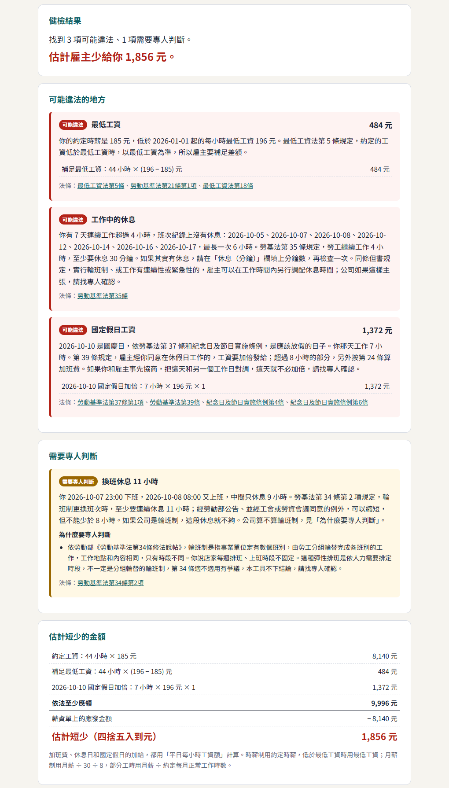
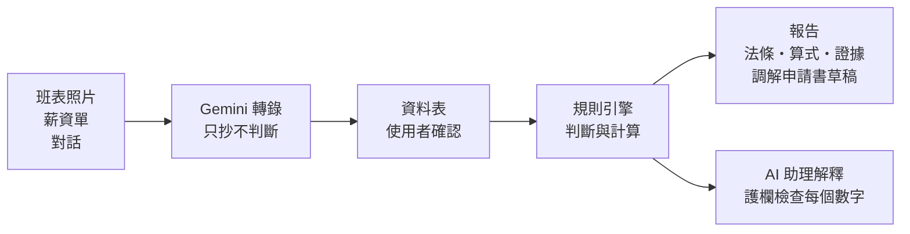

# 勞權雷達：AI 打工族勞基法健檢

上傳班表照片或薪資單，或用對話說明工作情況，勞權雷達會檢查雇主有沒有少給工資，並算出差多少。每一項結果都附上法條出處和算式。

2026 NextWave AI 法創黑客松參賽作品（隊名：權哥）。

> **這是法律資訊，不是法律意見。**結果是用使用者提供的資料和公開的法條算出來的。資料不完整或情況特殊時可能不準。正式主張權利前，請先洽各地勞工局、1955 專線或法律扶助基金會。

## 不用安裝，先看這幾樣

- 示範影片（1 分 56 秒，含 AI 助理的實際操作畫面）：https://youtu.be/rxm3ZJ9R2HU
- 下面這張圖：在表單模式按「載入範例」、再按「開始健檢」後的報告畫面。不需要任何金鑰。
- 完整報告，含證據清單和勞資爭議調解申請書草稿：[`samples/lin_xiaomei.output.md`](samples/lin_xiaomei.output.md)
- AI 助理用 Gemini 2.5 Flash 實際跑一遍的對話紀錄，每一步呼叫了哪個工具都記下來：[`samples/agent_demo.transcript.md`](samples/agent_demo.transcript.md)
- Gemini 讀班表照片：原始照片 [`samples/schedule_lin_xiaomei.jpg`](samples/schedule_lin_xiaomei.jpg)，讀出的資料 [`samples/schedule_lin_xiaomei.extracted.json`](samples/schedule_lin_xiaomei.extracted.json)



## 為什麼做這個

打工族、學生、外送員和移工最常遇到的勞資問題，是時薪低於最低工資、國定假日沒有加倍、加班沒算加班費。法條都查得到，但一般人很難把自己的班表對照到條文，再算出金額。移工還多了語言障礙。

## 怎麼運作



**AI 不判斷合不合法，也不計算金額。**

- **讀資料**：Gemini 視覺模型只把照片轉成文字，輸出受 JSON Schema 約束，填回資料表讓使用者確認。
- **判斷**：確定性的規則引擎依日期套用各年度的最低工資和國定假日，每條規則都連到全國法規資料庫的原文。
- **只問會改變結果的題目**：程式把每個可能的答案代進規則引擎各算一次，結果不同才問。不影響結果的題目也會列出來。
- **三道寫死在程式裡的關卡**：
  1. 使用者按「確認資料」前，AI 助理拿不到規則引擎的結果。
  2. AI 填的每個值都先驗證，原話必須逐字出現在使用者的訊息裡。
  3. 護欄檢查 AI 說出的每個數字、日期和條號都有依據。引擎結果出來前，AI 不能說「違法」「少給」。
- **看不出結論的不下結論**：例如兼職的每週排班算不算輪班制有爭議，這種情況只列「需要專人判斷」，並說明原因。


## 檢查的 11 項規定

| 項目 | 主要依據 |
|---|---|
| 最低工資 | 最低工資法第 5 條、第 18 條，勞動基準法第 21 條第 1 項 |
| 正常工時 | 勞動基準法第 30 條第 1 項 |
| 加班費 | 勞動基準法第 24 條第 1 項 |
| 每日工時上限 | 勞動基準法第 32 條第 2 項 |
| 每月加班上限 | 勞動基準法第 32 條第 2 項、第 36 條第 3 項 |
| 每三個月加班上限 | 勞動基準法第 32 條第 2 項、第 36 條第 3 項，勞動基準法施行細則第 22 條第 1 項 |
| 換班休息 11 小時 | 勞動基準法第 34 條第 2 項 |
| 工作中的休息 | 勞動基準法第 35 條 |
| 例假（七休一） | 勞動基準法第 36 條第 1 項、第 40 條 |
| 休息日出勤加給 | 勞動基準法第 24 條第 2 項 |
| 國定假日工資 | 勞動基準法第 37 條第 1 項、第 39 條，紀念日及節日實施條例 |

法條和行政解釋的原文收在 [`labor_radar/rules/sources.md`](labor_radar/rules/sources.md)。

## 範例結果

虛構案例「林小美」，在手搖飲店打工，時薪 185 元，兩週共 44 小時：

- 找到 3 項可能違法：時薪低於最低工資 196 元、連續工作超過 4 小時沒有休息、國慶日上班沒有加倍。
- 1 項需要專人判斷：換班間隔只有 9 小時，但每週排班算不算輪班制有爭議。
- 估計雇主少給 **1,856 元**（補足最低工資 484 元＋國定假日加倍 1,372 元）。

完整報告在 [`samples/lin_xiaomei.output.md`](samples/lin_xiaomei.output.md)，包含證據清單和勞資爭議調解申請書草稿。

## 其他功能

- 證據清單，以及照高雄市政府勞工局表單格式產生的調解申請書草稿
- 1955 專線、各地勞工局和法律扶助基金會的轉介資訊
- 越南文、印尼文、泰文介面（機器翻譯草稿，畫面上會標示）

## 自己跑起來

先裝 [uv](https://docs.astral.sh/uv/)，它會自動準備 Python 3.12 以上的環境。下載這個 repo 後，在資料夾裡執行：

```bash
uv sync
uv run uvicorn labor_radar.web:app --port 8730
```

Windows 的 PowerShell、Linux 和 WSL 都用同一組指令，在 Windows 11 和 WSL 上實測過。

瀏覽器開 <http://127.0.0.1:8730>，按「載入範例（虛構的林小美）」，再按「開始健檢」。接著可以看這幾處：

1. 最上面的「估計雇主少給你 1,856 元」，以及每一項的算式。
2. 點任一個法條連結，會開到全國法規資料庫的條文原文。
3. 往下捲是「要準備的證據」「勞資爭議調解申請書草稿」和「可以找誰幫忙」，草稿可以下載。
4. 右上角「語言」換成 Tiếng Việt，同一份報告變成越南文，畫面會標示這是機器翻譯草稿。

沒有 Gemini 金鑰時，表單模式的健檢照常可用。要讀照片或用 AI 助理，先設定環境變數 `GEMINI_API_KEY` 再啟動。照片和對話會傳給 Google Gemini 處理，示範時請用虛構資料。

不開網頁，直接在命令列跑範例：

```bash
uv run python -m labor_radar samples/lin_xiaomei.json
```

## 測試

```bash
uv run pytest -q
```

共 367 個測試。規則的預期金額是從條文手算的，不是把程式的輸出抄回來。

## 企劃書寫的功能，在程式哪裡

| 企劃書的說法 | 程式與紀錄 |
|---|---|
| 所有輸入先驗證，才交給規則引擎 | `labor_radar/intake.py` |
| Gemini 只把照片轉成表格 | `labor_radar/extraction.py`；實際讀取結果在 `samples/schedule_lin_xiaomei.extracted.json` |
| 11 項規定，每項一個檢查函式 | `labor_radar/rules/registry.py` 的 `RULES` |
| 最低工資依日期套用 2026 年 196 元、2027 年 205 元 | `labor_radar/rules/minimum_wage.py` |
| 國定假日依紀念日及節日實施條例 | `labor_radar/rules/holidays.py` |
| 不知道 7 日週期起算日時，7 種都算，採金額最低的一種 | `labor_radar/engine.py` |
| 法條原文與函釋出處 | `labor_radar/rules/sources.md` |
| 只問會改變結果的題目 | `labor_radar/agent/questions.py` |
| 確認前拿不到規則引擎、每筆事實要附原話 | `labor_radar/agent/tools.py`（`ALLOWED`、`set_facts`） |
| 守門員檢查數字、日期、條號和「違法」「少給」這類用語 | `labor_radar/agent/guard.py` |
| 證據清單、調解申請書草稿、轉介 | `labor_radar/report.py`、`paperwork.py`、`referrals.py` |
| 網頁 | `labor_radar/web.py`（FastAPI）、`labor_radar/static/` |

各模組的細節、每年要更新的資料、新增規則的步驟，見 [README_dev.md](README_dev.md)。
