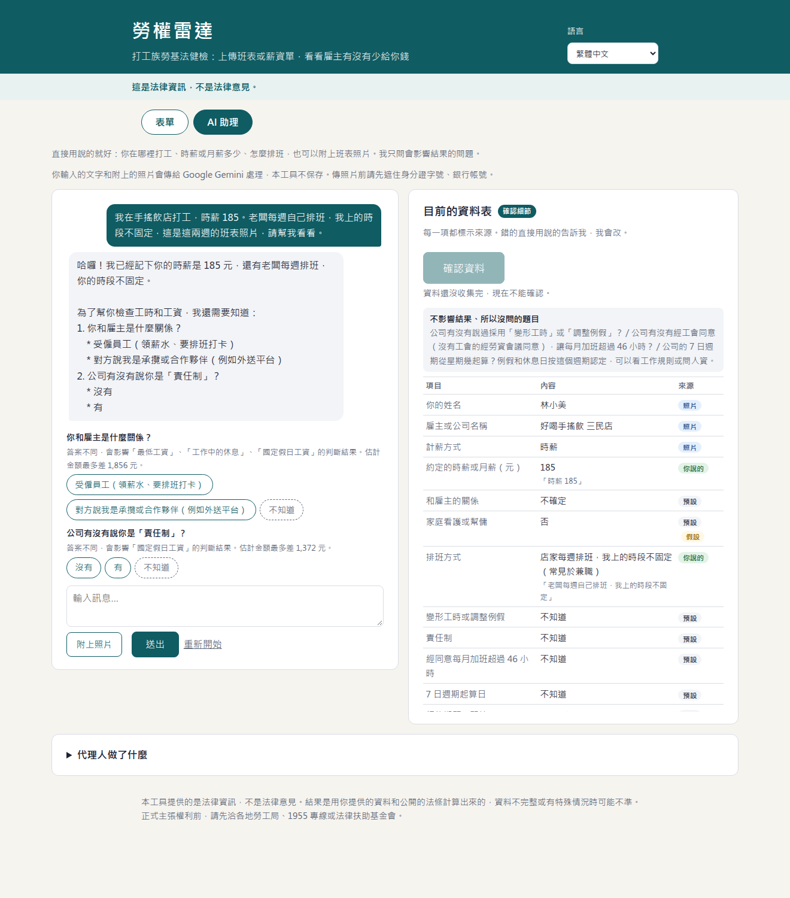
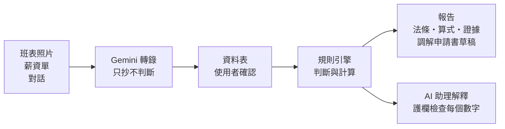

# 勞權雷達：AI 打工族勞基法健檢

上傳班表照片或薪資單，或用對話說明工作情況，勞權雷達會檢查雇主有沒有少給工資，並算出差多少。每一項結果都附上法條出處和算式。

2026 NextWave AI 法創黑客松參賽作品（隊名：權哥）。

> **這是法律資訊，不是法律意見。**結果是用使用者提供的資料和公開的法條算出來的。資料不完整或情況特殊時可能不準。正式主張權利前，請先洽各地勞工局、1955 專線或法律扶助基金會。

- 示範影片（1 分 56 秒）：https://youtu.be/rxm3ZJ9R2HU
- 開發說明：[README_dev.md](README_dev.md)



## 為什麼做這個

打工族、學生、外送員和移工最常遇到的勞資問題，是時薪低於最低工資、國定假日沒有加倍、加班沒算加班費。法條都查得到，但一般人很難把自己的班表對照到條文，再算出金額。移工還多了語言障礙。

## 怎麼運作



**AI 不判斷合不合法，也不計算金額。**

- **讀資料**：Gemini 視覺模型只把照片轉成文字，輸出受 JSON Schema 約束，填回資料表讓使用者確認。
- **判斷**：確定性的規則引擎依日期套用各年度的最低工資和國定假日，每條規則都連到全國法規資料庫的原文。
- **只問會改變結果的題目**：程式把每個可能的答案代進規則引擎各算一次，結果不同才問。不影響結果的題目也會列出來。
- **三道寫死在程式裡的關卡**：
  1. 使用者按「確認資料」前，AI 助理拿不到規則引擎的結果。
  2. AI 填的每個值都先驗證，原話必須逐字出現在使用者的訊息裡。
  3. 護欄檢查 AI 說出的每個數字、日期和條號都有依據。引擎結果出來前，AI 不能說「違法」「少給」。
- **看不出結論的不下結論**：例如兼職的每週排班算不算輪班制有爭議，這種情況只列「需要專人判斷」，並說明原因。

## 檢查的項目

| 項目 | 主要依據 |
|---|---|
| 最低工資 | 最低工資法第 5 條、第 18 條，勞動基準法第 21 條第 1 項 |
| 正常工時 | 勞動基準法第 30 條第 1 項 |
| 加班費 | 勞動基準法第 24 條第 1 項 |
| 每日工時上限 | 勞動基準法第 32 條第 2 項 |
| 每月、每三個月加班上限 | 勞動基準法第 32 條第 2 項、第 36 條第 3 項 |
| 換班休息 11 小時 | 勞動基準法第 34 條第 2 項 |
| 工作中的休息 | 勞動基準法第 35 條 |
| 例假（七休一） | 勞動基準法第 36 條第 1 項、第 40 條 |
| 休息日出勤加給 | 勞動基準法第 24 條第 2 項 |
| 國定假日工資 | 勞動基準法第 37 條第 1 項、第 39 條，紀念日及節日實施條例 |

法條和行政解釋的原文收在 [`labor_radar/rules/sources.md`](labor_radar/rules/sources.md)。

## 範例結果

虛構案例「林小美」，在手搖飲店打工，時薪 185 元，兩週共 44 小時：

- 找到 3 項可能違法：時薪低於最低工資 196 元、連續工作超過 4 小時沒有休息、國慶日上班沒有加倍。
- 1 項需要專人判斷：換班間隔只有 9 小時，但每週排班算不算輪班制有爭議。
- 估計雇主少給 **1,856 元**（補足最低工資 484 元＋國定假日加倍 1,372 元）。

完整報告在 [`samples/lin_xiaomei.output.md`](samples/lin_xiaomei.output.md)，包含證據清單和勞資爭議調解申請書草稿。

## 其他功能

- 證據清單，以及照高雄市政府勞工局表單格式產生的調解申請書草稿
- 1955 專線、各地勞工局和法律扶助基金會的轉介資訊
- 越南文、印尼文、泰文介面（機器翻譯草稿，畫面上會標示）

## 執行

需要 Python 3.12 以上和 [uv](https://docs.astral.sh/uv/)。

```bash
uv sync
uv run uvicorn labor_radar.web:app --port 8730
```

瀏覽器開 <http://127.0.0.1:8730>，按「載入範例（虛構的林小美）」，再按「開始健檢」。

沒有 Gemini 金鑰時，表單模式的健檢照常可用。要讀照片或用 AI 助理，先設定環境變數 `GEMINI_API_KEY` 再啟動。照片和對話會傳給 Google Gemini 處理，示範時請用虛構資料。

不開網頁，直接在命令列跑範例：

```bash
uv run python -m labor_radar samples/lin_xiaomei.json
```

## 測試

```bash
uv run pytest -q
```

共 367 個測試。規則的預期金額是從條文手算的，不是把程式的輸出抄回來。

## 程式結構

| 位置 | 內容 |
|---|---|
| `labor_radar/intake.py` | 所有輸入的唯一入口，驗證後才交給規則引擎 |
| `labor_radar/extraction.py` | Gemini 照片轉錄 |
| `labor_radar/rules/` | 法條引用、最低工資年度表、國定假日表、規則 |
| `labor_radar/engine.py` | 跑全部規則，並和薪資單比對 |
| `labor_radar/report.py`、`paperwork.py`、`referrals.py` | 報告、調解申請書草稿、轉介 |
| `labor_radar/agent/` | AI 助理：案件狀態、選題、工具、護欄 |
| `labor_radar/web.py`、`labor_radar/static/` | FastAPI 後端和網頁 |

各模組的細節、每年要更新的資料、新增規則的步驟，見 [README_dev.md](README_dev.md)。
